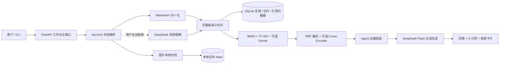
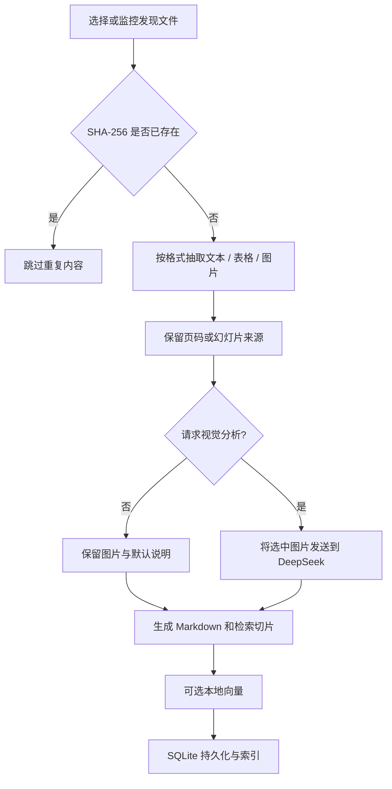

# 系统架构与关键流程

## 架构概览

此系统采用本地优先边界：原始文件、解析后的 Markdown、图片、SQLite 与评估集默认保存在 `DATA_DIR`。只有 Agent 生成回答时，当前问题和检索出的片段发送到配置的对话 API；只有上传时明确打开图片理解，图片才发送到视觉 API。不要把“本地优先”描述成“所有处理完全离线”。

## 文档入库流程

入库时按页切片；长段落切到约 900 字符，并保留上一片尾部约 120 字符作为上下文重叠。PDF 页码来自实际页；PPT 使用幻灯片编号；Word 页面位置是近似值。图片语义说明会关联图像 id，因此检索命中的图文证据可展示同一图片。

## 问答与引用流程

1. 对原问题及规则拆分出的子问题分别做检索。
2. 每个子问题由 BM25、TF-IDF 和已启用时的 Dense 通道召回；使用倒数排序融合去重。
3. 可选 Cross-Encoder 对候选结果重排，取 Top-K 证据。
4. 把证据包装成 `[S1 | 文档 | 页码]`，连同 `AGENTS.md` 的回答约束发送给 DeepSeek。
5. 返回答案与引用元数据；前端使用 DOM 节点安全渲染基本 Markdown 和流程图，并展示文档名、页码、原文摘录和相关图片。

当证据为空时，系统不会调用模型编造答案；回答应要求用户先导入可检索文档。模型输出仍需人工对照引用核验，引用存在不等于结论必然正确。

## 可替换点与运行边界

- 对话/视觉模型：`docqa/service/llm.py` 封装兼容 Chat Completions 的请求，配置集中在 `docqa/config.py`。
- 检索器：`docqa/docbase/retriever.py`；本地向量及重排通过配置选择，不改变 API 页面。
- 解析器：`docqa/doc2md/parser.py` 按扩展名分发，适合新增文件格式适配器。
- 工作约定：根目录 `AGENTS.md` 作为 Agent 的可编辑行为契约。
- 数据库：SQLite 便于单机课程项目部署；多用户并发、身份认证和远程服务不是当前目标。
